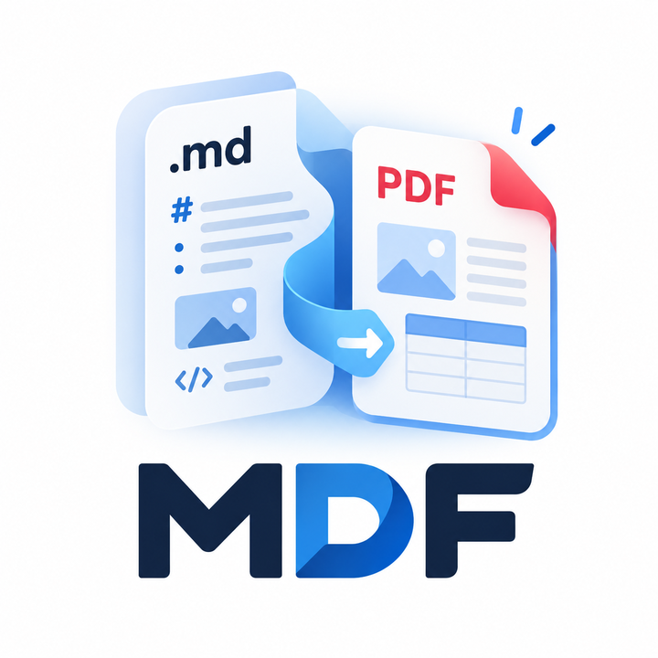
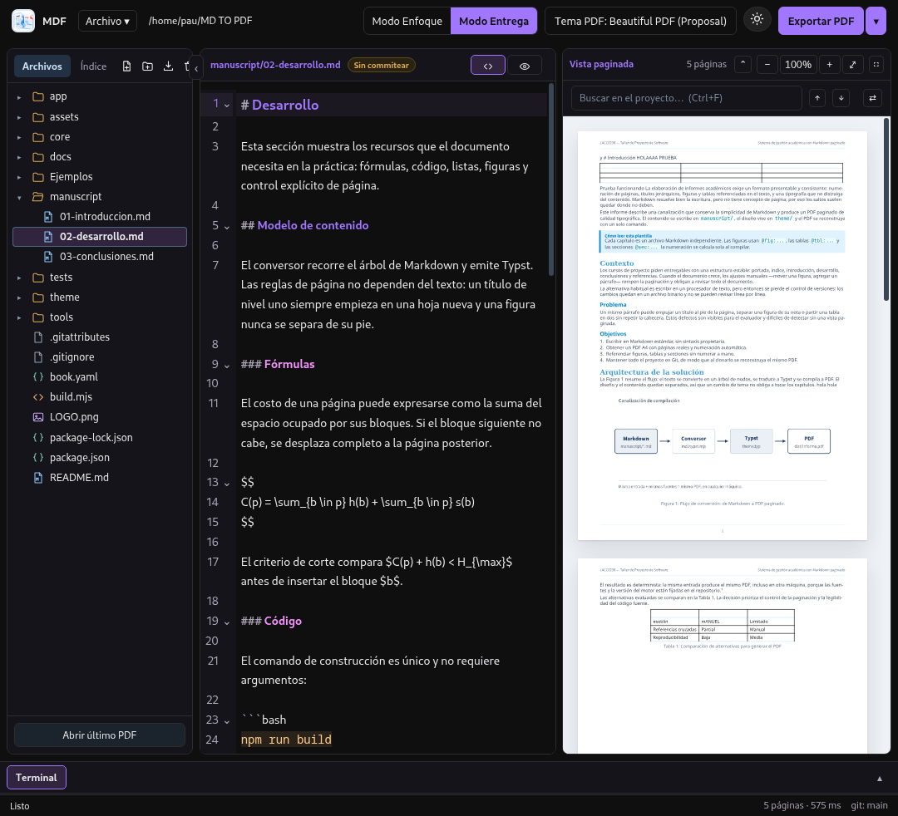
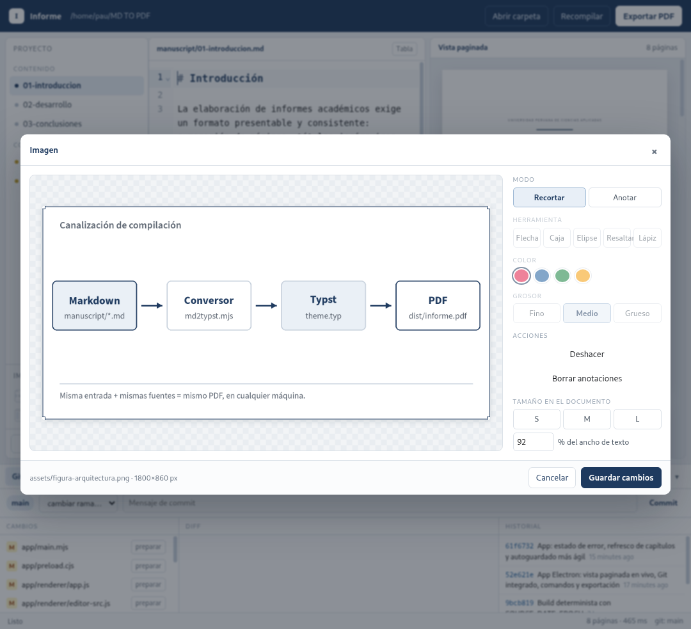
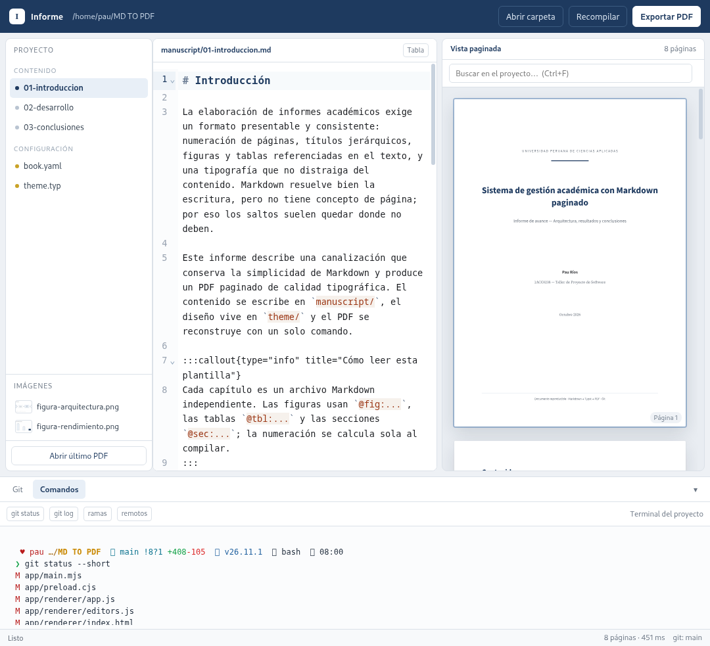
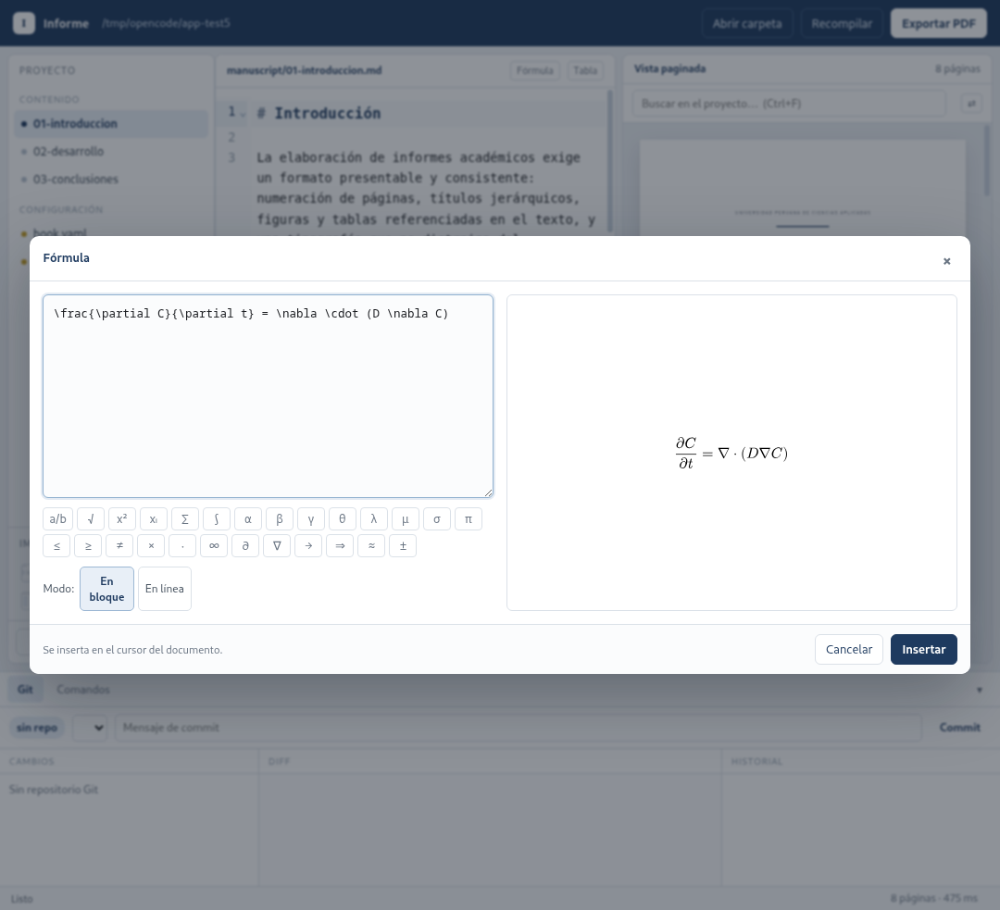

<p align="center">
  
</p>

# MDF — Markdown → PDF (A4, paginado)

Escribe en Markdown, obtén un PDF con **páginas reales**, numeración, figuras y tablas
referenciadas, y todo versionado en Git.

```
manuscript/*.md  ──►  md2typst  ──►  Typst  ──►  dist/informe.pdf
   (tú escribes)      (core/)        (theme/)      (entrega)
```



## Descargar la aplicación

Los ejecutables para usuarios finales se publican en
[GitHub Releases](https://github.com/SeviNy0/MDF/releases). No hace falta instalar
Node.js, Electron ni Typst: cada paquete incluye el runtime y el compilador.

- **Windows 10/11 x64**: `MDF-<versión>-x64-portable.exe`.
- **Linux x64**: `MDF-<versión>-x86_64.AppImage` (portable) o
  `MDF-<versión>-amd64.deb` (Debian/Ubuntu).

### Linux

```bash
chmod +x MDF-<versión>-x86_64.AppImage
./MDF-<versión>-x86_64.AppImage
```

Si falta FUSE:

```bash
./MDF-<versión>-x86_64.AppImage --appimage-extract-and-run
```

Para Debian/Ubuntu:

```bash
sudo apt install ./MDF-<versión>-amd64.deb
```

### Windows

Descarga el `.exe` portable y ejecútalo. Si SmartScreen muestra una advertencia por
no estar firmado, usa **Más información → Ejecutar de todas formas**.

Los binarios **no se versionan en Git**: son artefactos de build y se adjuntan al
Release. El repositorio contiene el código y `package-lock.json`; la carpeta local
`release/` está ignorada.

## Requisitos

- Node.js 20+
- [Typst](https://typst.app) 0.15+ (`typst --version`)
- (Opcional) `pdfinfo` para reportar el número de páginas

Las fuentes están en `theme/fonts/` y **no** se descargan al compilar.

## Uso

```bash
npm install          # solo la primera vez
npm run app          # abre el editor con vista paginada
npm run build        # genera dist/informe.pdf sin abrir la app
npm run watch        # recompila al guardar (CLI)
```

### La app





- **Vista paginada en vivo**: cada cambio se guarda solo y se recompila (~400 ms) **sin mover el scroll**; ves las hojas A4 reales.
- **Zoom** del PDF (`−`, `+`, `⤢` ajustar, `Ctrl+rueda`, `Ctrl+0`).
- **Solo vista previa** (`⛶`) para trabajar únicamente sobre el documento; el buscador se puede plegar con `⌃`.
- **Edición desde el PDF**: clic en un título o párrafo → salta al código; clic en una figura → abre su recorte/anotación; clic en una tabla → abre el editor de columnas.
- **Sincronización inversa**: al mover el cursor en el Markdown, el preview va a esa hoja y marca el bloque.
- **Resaltado fino**: subrayado amarillo de una línea en el PDF (recuadro en figuras y tablas) y destello de la línea exacta en el Markdown.
- **Selección de texto nativa** en el editor (sin arrastrar bloques).
- **Editor Markdown** con resaltado, plegado y búsqueda.
- **Barra lateral con dos vistas**: **Archivos** (árbol) e **Índice** (texto exacto de los títulos y página; clic para saltar a la hoja y a la línea). Solo muestra los títulos escritos en tus `.md`. Se puede ocultar con la flecha del borde y ensanchar arrastrando ese mismo borde; el ancho y el estado se recuerdan.
- **Explorador de archivos**: árbol con iconos por tipo, crear/eliminar archivos y carpetas, abrir la carpeta en el sistema y **agregar archivos desde el sistema** (botón de importar o arrastrándolos desde Dolphin/Nautilus). Las imágenes se abren con el editor al hacer clic.
- **Estado de Git** en la barra inferior: `branch` actual y cambios pendientes. Las operaciones de Git se hacen desde la terminal del proyecto.
- **Terminal real** del proyecto (PTY con redimensionado), con **varias sesiones**: el título **Terminal** agrupa las pestañas, `+` crea una nueva y `×` la cierra. Incluye **botones de git personalizables** (los editas como `nombre | comando`).
- **Modos Código y Lectura** (como Obsidian), con iconos junto al archivo: *Código* muestra el Markdown editable; *Lectura* lo renderiza (títulos, listas, tablas, imágenes y callouts) sin poder editar. El lápiz **Editar** vuelve al código; las tablas renderizadas tienen su propio botón **Editar tabla**. El botón **+** del editor abre un menú para insertar **ecuación**, **tabla**, **salto de página** o **nota/aviso**, sin salir del código.
- **Estado junto al archivo**: `Guardado`, `Sin guardar`, `Sin commitear`, `Sin push` o `Sin pull`, según corresponda.
- **Modo oscuro** (☾/☀) persistente, con contraste revisado en árbol, índice, tablas y diálogos.
- **Búsqueda en el proyecto** (`Ctrl+F`): resultados con archivo y línea, flechas ↑/↓ o `Enter`/`Shift+Enter` para recorrer coincidencias, texto resaltado en el editor, historial (`Alt+↑/↓`) y reemplazo global.
- **Documentos largos**: la vista paginada carga solo las páginas cercanas al scroll (y libera las lejanas), así un documento de 400+ páginas no llena la RAM. Probado con 435 páginas: compilación en ~3,5 s, ~17 MB de heap de JavaScript y 4–8 SVG cargados a la vez. En archivos de más de 250 KB el editor desactiva el resaltado sintáctico para ahorrar RAM; el modo Lectura y el PDF siguen formateados.
- **Páginas del preview con enlaces**: Typst dejaba los `&` de las URLs sin escapar dentro del SVG; eso invalidaba el XML y hacía que Chromium ocultara la página entera. Ahora se escapan al servir la página y todas aparecen.
- **Menú `/`** en el editor: escribe `/` y elige **Tabla** (Markdown estándar, compatible con GitHub), **Tabla con título** (con pie/anchos de Informe), **Imagen** (abre el selector de archivos), **Enlace**, **Ecuación**, **Nota/aviso**, **Salto de página**, **Título** o **Lista**. Los saltos de página usan `<!-- pdf-pagebreak -->`, un comentario invisible en GitHub.
- **Editor de fórmulas** con vista previa real y paleta de símbolos.
- **El preview sigue al archivo abierto**: si seleccionas un `.md` que no está en `book.yaml` (por ejemplo `README.md`), el panel derecho compila **ese archivo** y muestra sus páginas; si seleccionas un capítulo, muestra el libro. La etiqueta junto a “Vista paginada” indica `Libro` o el nombre del archivo.
- **Clic en una página → salta al bloque fuente** correspondiente en el editor.
- **Doble clic en una tabla de Lectura** (GFM, `:::table` o HTML): abre el editor visual. **Doble clic en una imagen** o **clic derecho → Editar imagen…**: abre el mismo panel de URL, alt, ancho y alineación; el código guardado usa `<div align="…"></div>`.
- **Índice lateral**: muestra el texto de tus títulos (con la numeración que ya tengas escrita), sin añadir números automáticos.
- **Numeración manual**: el PDF y el índice muestran los títulos tal como están escritos en el `.md`, sin prefijos calculados.
- **Exportar** a PDF, HTML o Word (DOCX) desde el menú `=` o desde **Exportar ▾**.
- Atajos: `Ctrl+O` abrir carpeta, `Ctrl+S` guardar, `Ctrl+1` Código, `Ctrl+2` Lectura, `F5` actualizar la vista.

La compilación es **automática** al guardar: no hay que pulsar «Recompilar». Si quieres forzarla (por ejemplo tras cambiar el tema), usa **= → Actualizar vista** (`F5`).

### Enfoque, Entrega y edición rápida

- **Modo Entrega** (predeterminado) conserva el PDF paginado. **Modo Enfoque** muestra el editor a la izquierda y la lectura continua a la derecha, sin compilar Typst mientras escribes; sincroniza suavemente el bloque visible en ambos sentidos. Al volver a Entrega se recompila el Markdown y vuelve la vista de hojas. Tablas e imágenes de lectura conservan su doble clic.
- Escribe `/` para abrir el menú vertical de bloques: texto, encabezados H1–H4, listas, tareas, código, cita, destacado, ecuación, imagen y tabla GFM. «Destacado» utiliza `> **Nota:** …` (cita Markdown normal). Un salto de página no forma parte del Markdown/GFM nativo: la opción «Página» inserta el comentario HTML `<!-- pdf-pagebreak -->`, ya admitido por Informe e invisible en GitHub.
- `/imagen` abre el selector y **copia siempre** la imagen a `assets/` (también desde el Escritorio); el `.md` inserta HTML con el formato ``. Si hay un nombre repetido se crea otra copia numerada.
- Selecciona texto **con el ratón** y haz clic derecho dentro de la selección para aplicar negrita, cursiva, subrayado HTML, limpiar formato, enlace, tachado, código en línea o ecuación. «Más opciones» contiene **Centrar párrafo**. Sin selección no aparece este menú.
- Los colores de tablas en lectura y HTML exportado proceden del tema de documento seleccionado; las tablas GFM y HTML crudo comparten estilos. En PDF los bordes y cabeceras HTML se dejan al tema Typst, en lugar de imponer rellenos fijos desde el conversor.

### Documentos largos (600+ páginas)

- Un clic en una hoja del PDF salta al archivo y a la línea exactos del Markdown. El índice de coordenadas se calcula **en paralelo** con el render SVG y se copia a la interfaz una sola vez por compilación, así que el clic no espera a Typst ni recorre todo el libro.
- Cambiar de capítulo o abrir un resultado de búsqueda **no recompila** si el libro visible no cambió. Antes, navegar por el PDF lanzaba otra compilación completa.
- Cada hoja lleva una URL con el hash de su contenido. Al escribir solo se vuelven a cargar las hojas que cambiaron de verdad; las demás conservan su imagen ya decodificada. Las hojas del DOM se reutilizan y solo se añaden o quitan las que sobran.
- Escribir no serializa el documento completo en cada tecla: se guarda una vez tras la pausa. El índice de bloques, el árbol y las coordenadas de palabras se cachean por versión, y las palabras del PDF se filtran por página antes de cruzar el puente de Electron.
- El modo Enfoque pinta la lectura continua del capítulo sin compilar hojas; en la prueba de 611 páginas el cambio a Enfoque tardó ~0,14 s y un clic profundo en el PDF ~25 ms. El tiempo de compilación depende del equipo y del contenido; mide `N páginas · X ms` en la barra de la vista paginada.

### Temas del documento (PDF)

**Tema PDF** en la barra superior permite escoger **Beautiful PDF (Proposal)** (predeterminado), **Actual** (el `theme/theme.typ` existente, sin tocarlo), **Académico estructurado** (azul institucional), **Editorial contemporáneo** (terracota) o un tema propio. La selección se guarda en `documentTheme` dentro de `book.yaml` y recompila el preview y la exportación PDF; no afecta al modo claro/oscuro de la aplicación ni cambia el Markdown. Los temas instalados viven en `theme/presets/*.typ`.

El tema Beautiful PDF es una **adaptación a Typst** del perfil «Proposal» activo en Beautiful PDF 1.2.4 instalado localmente: A4, márgenes 18/16/16/16 mm, encabezados azules y tabla con cabecera azul. Obsidian usa HTML/CSS y fuentes KoPub no instaladas aquí; se sustituyen por Noto Sans/Noto Serif. Por ello no se promete identidad pixel a pixel ni se trasladan datos personales del encabezado de aquel perfil. La portada, el índice y la lista de figuras ya no se generan automáticamente: si los necesitas, escríbelos en el Markdown.

Para crear uno: **Tema PDF → Crear desde la plantilla**, escribe un nombre y edita el archivo que se abre en `theme/custom/<nombre>.typ`. La base completa está en `theme/templates/tema-personalizado.typ`; conserva la API `palette`, `tline`, `callout`, `page-header`, `page-footer` y `rules(cfg, body)`. Las funciones `cover`, `toc-page` y `lof-page` siguen en la plantilla por compatibilidad, pero el libro ya no las llama. También puedes copiar manualmente un `.typ` a `theme/custom/` usando un nombre en minúsculas con guiones: aparecerá en la lista al abrir el selector. Elige tu tema y pulsa **Aplicar tema**. Los archivos personalizados y el tema original nunca se sobrescriben al preparar el proyecto.

Para borrar un tema, selecciónalo en **Tema PDF → Borrar tema…** y escribe su **nombre exacto** o el **código mostrado** en la confirmación. «Actual» está protegido. Los temas preinstalados eliminados no se reinstalan al reabrir el proyecto; si borras el tema seleccionado se activa «Actual».

Al seleccionar una figura raster en la vista PDF, el recuadro amarillo usa el rectángulo pintado de la imagen en el SVG generado por Typst (no la altura de la figura y su pie). Si no hay un rectángulo de imagen verificable, no se dibuja un recuadro estimado. Las imágenes vectoriales convertidas a trazos por Typst pueden no exponer ese rectángulo.

**Abrir una carpeta cualquiera funciona**: si faltan `book.yaml` o `theme/`, la app los crea automáticamente con el tema incluido y usa todos los `.md` de la carpeta como capítulos (en orden alfabético) hasta que edites `book.yaml`. Si `book.yaml` no fija capítulos y existe `README.md`, se abre como documento principal y el preview compila ese archivo. También puedes abrir carpetas sin ningún `.md`: verás el editor vacío y podrás crear archivos.

### Imágenes (recorte y anotación)

Haz clic en una figura **dentro del PDF** o en un archivo de imagen del árbol. Se abre el editor:

- **Recortar**: arrastra el marco o sus esquinas.
- **Anotar**: flecha, caja, elipse, resaltado, lápiz y texto; color y grosor; deshacer.
- **Herramienta por defecto**: flecha.
- **Tamaño**: S / M / L, **ancho en %**, **alto exacto** (por ejemplo `40mm`) y **ajuste** (`contain`, `cover`, `stretch`).
- **Copiar estilo / Pegar estilo** (ancho, alto y ajuste) con **clic derecho** sobre la imagen o desde el editor.

El original **no se modifica**: los cambios se guardan en `assets/<archivo>.edit.json` (versionado). Al compilar, las imágenes remotas (`http…`) se descargan a `build/remote/` para poder incluirlas en el PDF; si no hay red, se omiten. `build/` está ignorado por Git.
Al compilar se genera `build/derived/<archivo>-<hash>.png` con el recorte y las anotaciones aplicadas.
Si cambias el recorte después, las anotaciones siguen ancladas al contenido de la imagen.

### Modos Código y Lectura

Arriba del editor hay dos modos (como en Obsidian):

- **Código**: el Markdown tal cual, editable, con resaltado, búsqueda y los botones **Ecuación** y **Tabla**.
- **Lectura**: renderiza **el archivo abierto** (aunque no esté en `book.yaml`), con su HTML, imágenes relativas, listas, tablas, fórmulas y callouts; sin numeración automática, como la vista de lectura de Obsidian. El lápiz **Editar** activa la **edición dentro de la propia vista**: el formato se sigue viendo (no pasas a Markdown puro) y puedes escribir párrafos, títulos, listas, citas, código y notas. Al salir de un bloque (o pulsar **Esc**) se guarda en el `.md`; `Enter` crea un párrafo nuevo. Las tablas se editan con su botón **Editar tabla**.
- En **Lectura**, al pasar el ratón por una tabla aparece **Editar tabla**: abre el editor de tablas sin salir de la lectura. Al guardar, la vista se actualiza sola.
- El modo **Código** sigue siendo el Markdown tal cual, con resaltado y edición normal.

El modo se recuerda entre sesiones (`Ctrl+1` / `Ctrl+2`).

### Terminal

El título **Terminal** abre una shell real en la raíz del proyecto (PTY con `node-pty`),
con historial, colores, redimensionado al tamaño del panel y los botones `git status`,
`git log`, `ramas` y `remotos`. El botón `+` crea otra terminal independiente y cada
pestaña se puede cerrar con `×`. Funciona en Linux/macOS con tu shell habitual y en
Windows con `cmd.exe`. Al seleccionar texto con el ratón, se copia automáticamente al
portapapeles.

Si `node-pty` no carga tras instalar, ejecuta `npm run native:rebuild` (lo hace `npm run app`).

### Búsqueda y reemplazo

`Ctrl+F` abre el buscador del proyecto. Muestra archivo, línea y coincidencia; al hacer clic
abre el capítulo, selecciona el texto (y resalta todas las apariciones en el editor) y
desplaza la vista paginada a la hoja correspondiente.

`Enter` / `Shift+Enter` o las flechas ↑/↓ recorren las coincidencias; `Alt+↑/↓` recorre el
historial de búsquedas.

El botón **⇄** muestra el campo de reemplazo: `Reemplazar todo` cambia todas las
coincidencias en los capítulos (con confirmación) y recompila.

### Fórmulas



El botón **Ecuación** inserta una fórmula matemática en el documento (LaTeX). Abre un editor con:

- LaTeX en la izquierda y **vista previa real** (Typst) a la derecha.
- Paleta de fracciones, raíces, sumatorias, integrales, griegas y operadores.
- **Favoritos**: guarda fórmulas con nombre y reutilízalas con un clic.
- Modo en bloque (`$$…$$`) o en línea (`$…$`).
- `Insertar` escribe la fórmula en la posición del cursor.

### Tablas (estilo Word)

Pulsa **Tabla**: si el cursor está dentro de una tabla, la edita; si no, abre el diálogo para
**insertar una tabla nueva** eligiendo columnas y filas de datos.

Dentro del editor:

- **Clic derecho** sobre una celda: **Agregar fila arriba/abajo**, **Agregar columna a la izquierda/derecha**, eliminar fila/columna, combinar/dividir y copiar/pegar estilo.
- Barra de iconos: **combinar**, **dividir**, **igualar columnas**, **igualar filas**, **alto automático**, **ancho automático**, **copiar estilo** y **pegar estilo**.
- **Escribe dentro de la tabla**: doble clic en una celda para editar su contenido (`Enter` confirma, `Esc` cancela). Las celdas crecen y muestran todo el texto.
- **Anchos**: arrastra los divisores de la barra **o el borde de una columna en la propia tabla**, o escribe el % exacto.
- **Altos**: valor por fila en mm o `auto`.
- **Alineación** en tres modos: **General** (todas), **Por columna** y **Por celda**.
- **Combinar celdas** y **Dividir celdas** (selecciona con clic, `Shift+clic` o arrastrando).
- **Copiar estilo / Pegar estilo** (solo los anchos) desde la barra o con **clic derecho** sobre la tabla.
- **Clic derecho sobre una tabla del PDF → Centrar tabla / Alinear a la izquierda / Alinear a la derecha**. En tablas HTML actualiza `align` y los márgenes automáticos; en tablas GFM guarda la alineación en su comentario invisible. Las tablas HTML que ya traen `align="center"` o `margin-left:auto;margin-right:auto` se centran también sin tocar el código.
- Al guardar una tabla Markdown se escribe una tabla **GFM** (`| … |` y `|:---:|`); las tablas HTML existentes conservan su estructura HTML. Anchos, pie, referencia y combinaciones —imposibles de expresar en GFM— se conservan en un comentario invisible `<!-- mdpdf-table:… -->` anterior a la tabla: GitHub/Obsidian muestran la tabla GFM, y el PDF conserva esos ajustes. GitHub no representa visualmente las combinaciones ni los anchos personalizados. Al guardar una tabla HTML se compacta en una sola línea para que las líneas en blanco no corten el bloque; las tablas antiguas ya partidas se siguen mostrando como tabla y se reparan al volver a guardarlas.
- La selección precisa en la vista PDF requiere `pdftotext` (Poppler) instalado; se extraen coordenadas de palabras del PDF compilado. Si no está disponible, no se inventa un sombreado de palabras.
- Con más de cinco columnas, el diálogo puede ampliarse arrastrando su esquina inferior derecha; respeta un margen lateral mínimo del 15 % en pantallas de escritorio y permite desplazar horizontalmente el contenido de la tabla.
- El panel de imágenes (véase `Ejemplos/imagen.png`) permite elegir URL/archivo, ver la imagen, ajustar ancho en `%` o `px`, alineación, pie, referencia, alto y enlace. Se abre igual con **doble clic** o con **clic derecho → Editar imagen…**. El PDF conserva juntos imagen y pie; Typst reescala imágenes muy altas antes de paginar.
- Los encabezados de niveles 1–6 se mantienen junto al contenido siguiente al paginar el PDF. Si una figura completa es más alta que el área de una página, se limita a una altura segura manteniendo su proporción.
- Al recompilar, `build/book.typ` incluye el helper de ajuste de imágenes; los proyectos con una copia anterior de `theme/theme.typ` siguen funcionando sin sobrescribir su tema.
- **Clic derecho en un párrafo del editor Código → Centrar párrafo**: escribe de inmediato `<p align="center">…</p>`; en un párrafo HTML existente actualiza su atributo `align` y el posible `text-align`. La vista de lectura y la vista paginada se actualizan automáticamente. Se excluyen bloques de código, listas y tablas para no alterar su estructura.
- El tema oscuro usa fondo #0f0f0f y superficies #15141b con acento violeta. El documento de Lectura y las páginas PDF permanecen blancos; el botón de tema conserva la alternativa clara.
- Las **tablas HTML** que ya traiga el `.md` (por ejemplo `<table><tr><td colspan=…>`) se convierten a tablas Typst en el PDF, incluidas celdas combinadas e imágenes dentro de las celdas.

## Cómo se arma el PDF (por qué hay varios .md)

- `book.yaml`: metadatos (título, autores, curso) y **orden de los capítulos**.
- `manuscript/01-introduccion.md`, `02-desarrollo.md`, `03-conclusiones.md`: un archivo por capítulo; `#` inicia un capítulo.
- `core/md2typst.mjs`: convierte cada capítulo a Typst.
- `build/book.typ`: concatena todos los capítulos en un solo documento.
- `theme/theme.typ`: define **encabezados, pies, títulos, figuras, tablas y numeración**.
- Typst: genera el PDF (y el preview).

Por eso ves tres `.md` y un PDF único: el contenido se une en el orden indicado, sin páginas añadidas.
Para cambiar el orden: `book.yaml`. Para el diseño: `theme/theme.typ`.

## Estructura

```
book.yaml             metadatos, orden de capítulos y tamaño de página
manuscript/*.md       contenido (Markdown estándar + 4 directivas)
theme/theme.typ       diseño: títulos, figuras, tablas, callouts
theme/fonts/          fuentes versionadas (Source Serif, Source Sans, JetBrains Mono)
assets/               imágenes originales
core/md2typst.mjs     conversor Markdown → Typst
core/project.mjs      configuración, render y compilación (CLI y app)
app/                  aplicación Electron (main, preload, renderer)
build/book.typ        Typst generado (no editar)
build/preview/        SVG por página para la vista en vivo
dist/                 PDFs (ignorados por Git)
```

La app y la CLI comparten `core/`: el PDF que ves en el preview es el mismo que exportas.

Para agregar un capítulo: crea el `.md` (empieza con `# Título`) y añádelo a `chapters:` en `book.yaml`. Si `chapters` está vacío o no existe `book.yaml`, se usan todos los `.md` de la carpeta.

## Sintaxis

### Figuras

```markdown
{#fig:arquitectura width=85%}
```

Se referencia con `@fig:arquitectura`. El tamaño acepta `%`, `mm`, `cm`, `pt` o `full`.
La figura y su pie nunca se separan; si no cabe, pasa completa a la página siguiente.

### Tablas

```markdown
:::table{caption="Comparación de alternativas" widths="24 30 22 24" id="tbl:comparacion"}
| Criterio | A | B | C |
|:---|:---|:---:|---:|
| ... | ... | ... | ... |
:::
```

`widths` fija el ancho de cada columna (se normaliza al ancho de la página).
Se referencia con `@tbl:comparacion`.

### Saltos de página y bloques indivisibles

```markdown
:::pagebreak
:::
```

o una línea con `\newpage`.

```markdown
:::keep
Todo este bloque se mantiene en la misma página.
:::
```

### Callouts

```markdown
:::callout{type="info" title="Nota"}
Texto del aviso. Tipos: `info`, `warning`, `danger`, `success`.
:::
```

### Referencias y secciones

- `@sec:nombre` → número de sección (usa `{#sec:nombre}` tras el título o el slug automático).
- `@fig:...`, `@tbl:...` → «Figura 1», «Tabla 1».
- Los títulos se numeran solos (`1`, `1.1`, `1.1.1`).

### Idioma

El documento usa `lang: es` (guionizado y separación silábica en español).
Para texto en otro idioma: `:en[the quick brown fox]` (cualquier código ISO de dos letras).

### Matemáticas

Subconjunto de LaTeX: `\frac`, `\sqrt`, `\sum`, `\int`, letras griegas, `\le`, `\ge`,
`\times`, `\infty`, subíndices y superíndices. También acepta sintaxis Typst directa.

### Código

Bloques con ```` ```bash ```` y código en línea con `` ` ``.

## Paginación

- Cada capítulo (`#`) empieza en hoja nueva.
- Los títulos usan `sticky`, así que no quedan huérfanos al pie.
- Figuras, tablas y callouts son indivisibles; si no caben, se mueven completos.
- El cuerpo empieza en la página 1; no se añaden portada, índice ni lista de figuras.

## Git: clonar y reconstruir

Todo lo necesario está versionado: contenido, tema, fuentes, imágenes y configuración.

```bash
git clone <repo> && cd informe
npm install
npm run build
```

- `dist/` y `build/` se ignoran a propósito: el PDF se regenera.
- `node_modules/` se ignora; `npm install` lo reconstruye.
- No hay rutas absolutas ni estado fuera del repositorio.
- Para adjuntar el PDF de una entrega, etiqueta el commit y guarda el artefacto:

```bash
git tag entrega-1
```

### Exportar a HTML y Word

Desde la app: `Exportar ▾` → **HTML** o **Word (DOCX)**. Desde la terminal:

```bash
npm run export:html    # dist/informe.html
npm run export:docx    # dist/informe.docx
npm run export:all     # ambos (+ PDF)
```

- **HTML**: archivo único autocontenido (2–3 MB): fuentes, imágenes y fórmulas MathML embebidas; tablas y notas.
- **Word**: requiere [Pandoc](https://pandoc.org) instalado. Respeta figuras, tablas, notas al pie, matemáticas (OMML) y saltos de página, sin añadir índice ni numeración automática.
  El PDF sigue siendo la exportación principal; Word es para revisión o edición por terceros.

### Explorador de archivos

La barra izquierda muestra el árbol real del proyecto:

- Carpetas expandibles; los archivos `.md`, `.yaml`, `.typ`, `.json`, etc. se abren en el editor.
- Botones **＋** (archivo), **▣** (carpeta), **🗑** (eliminar) y **↗** (abrir la carpeta en el explorador del sistema).
- Al seleccionar una carpeta, los nuevos archivos se crean dentro de ella. Ideal para una carpeta `recursos/`.

### Preferencias

El tema, los comandos rápidos, los favoritos de fórmulas y el historial de búsqueda se guardan
en `~/.config/informe-md-pdf/settings.json` (fuera del repositorio). Así el PDF del proyecto
sigue siendo reproducible sin depender de la configuración de cada máquina.

## Empaquetar la app

```bash
npm run dist
```

Genera en `release/`:

- `MDF-0.2.1-x86_64.AppImage` (~158 MB)
- `MDF-0.2.1-amd64.deb` (~125 MB)
- `MDF-0.2.1-x64-portable.exe` (Windows, ~122 MB)

En Windows, desde PowerShell y con un `typst.exe` en `vendor/`:

```powershell
npx electron-builder --win portable --x64
```

El workflow `.github/workflows/build.yml` compila Linux y Windows en runners nativos
cuando se publica un tag `v*`, y adjunta los artefactos al Release.

El binario de **Typst se incluye** en el paquete (`vendor/typst` o `vendor/typst.exe`,
ignorados por Git), así que quien la instala no necesita Typst. Para compilar el paquete,
tenlo instalado o define `TYPST_PATH`; el script `tools/prepare-typst.mjs` lo copia.

Las compilaciones Linux empaquetadas desactivan el sandbox de Chromium (la app es local y
ejecuta comandos del proyecto por diseño).

## Estado y pendientes

Listo: vista paginada en vivo, autoguardado, estado de Git en la barra inferior,
runner de comandos, exportación, recorte/anotación de imágenes y editor visual de tablas
(anchos de columna y alto de fila) con build determinista.

Pendiente para la siguiente fase:

- Firma de los paquetes y publicación de releases.
- Colaboración en tiempo real (ver arriba).
- Exportación a LaTeX/Markdown unificado.
- Plantillas de portada por institución.

## Colaboración

Hoy el trabajo en equipo se resuelve con **Git**, que ya está integrado:

- Repositorio compartido, una rama por persona o entrega y *pull requests*.
- Como el contenido es Markdown, los conflictos se resuelven por bloque y se ven en el panel de diff.
- CI (GitHub Actions) puede compilar el PDF en cada push y publicarlo como artefacto.

Para edición **en tiempo real** (varios cursores) la ruta natural es:

1. **CRDT por archivo** (Yjs) con un servidor WebSocket pequeño (`y-websocket`) o un servicio gestionado.
2. Presencia, cursores y selección; el servidor persiste los cambios y crea *snapshots* que se commitean a Git.
3. Reparto de permisos por rama/proyecto y comentarios anclados a bloques en un sidecar versionado.

Recomendación: mantener Git como fuente de verdad y usar la sesión colaborativa como capa temporal que
genera commits; así no se pierde el historial ni la reproducibilidad del PDF.

## Desarrollo de la app

```
npm run editor:bundle   # recompila CodeMirror (app/renderer/vendor/editor.js)
npm run app:shot        # captura la ventana en /tmp/opencode/app.png (prueba visual)
```
